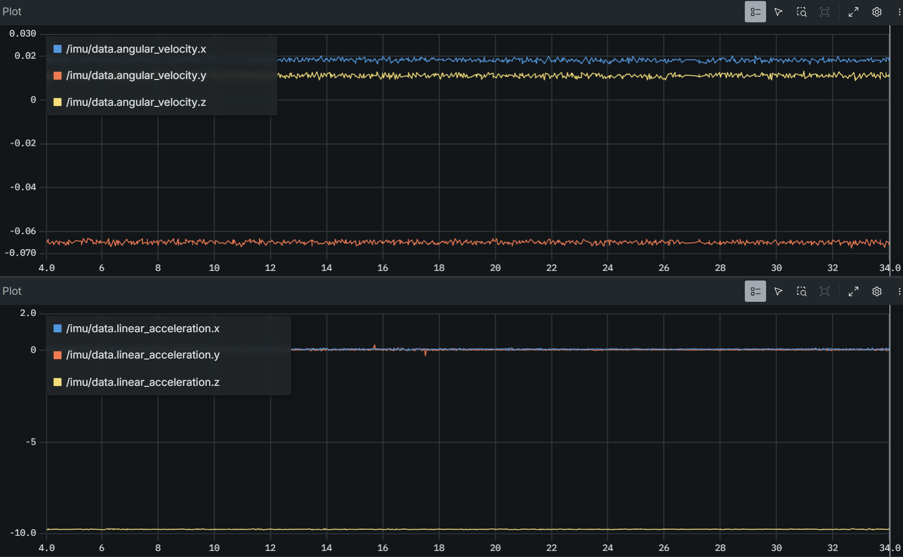
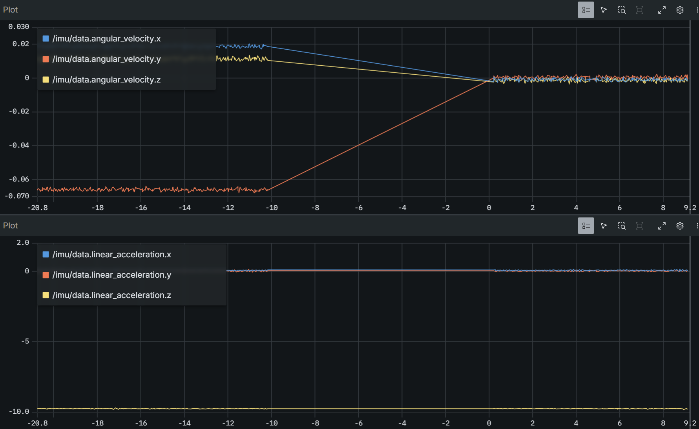

<!---
If you're new to markdown, check out this reference: https://www.markdownguide.org/basic-syntax/
-->

# Writeup

## Q0. Gyroscope Tuning (10 pts)

Untuned gyro:

Tuned gyro:

## Q2.1
<!-- Don't worry if these videos don't render. This is here as a reminder for you to include the videos at the correct file path!! -->
<video width="640" height="360" controls>
  <source src="./good_start.mov" type="video/mov">
  Your browser does not support the video tag.
</video>
<video width="640" height="360" controls>
  <source src="./bad_start.mov" type="video/mov">
  Your browser does not support the video tag.
</video>
<video width="640" height="360" controls>
  <source src="./driving_around.mov" type="video/mov">
  Your browser does not support the video tag.
</video>

## Q3.2

**How did the odometry only localization compare to the particle filter? Why would we expect the particle filter to perform better?**

**Experiment 1: Longer Route**

In the first experiment, we initialized the rover's position and drove it along a longer route around the map to observe how odometry-only localization performed over an extended distance.

The initial position and orientation were recorded using the `map → base_link` transform. The terminal output showed a translation of approximately `[0.307, 0.351, 0.000]` and a yaw of `55.505°` (`0.969` radians).

**Initial Coordinates:**

**Initial Map:**

**Final Map:**

From the Foxglove visualization, we can see the rover's estimated trajectory as it travels around the map. The green traces indicate the observed path, while the robot marker and direction indicators show its estimated pose. The longer route provides more opportunities for small errors in wheel encoder measurements, turning, and wheel slip to accumulate.

Since odometry only localization integrates the wheel velocities over time, any error in the estimated linear or angular velocity affects subsequent position estimates. Unlike AMCL, odometry does not use LiDAR observations to correct these errors. Therefore, we expect its localization accuracy to decrease as the rover travels farther.

**Experiment 2: Similar Route to Q3.1**

In the second experiment, we reinitialized the rover's position and drove it along a route similar to the one followed in Q3.1, allowing us to compare odometry-only localization with the particle filter under similar driving conditions.

**Initial Coordinates:**

**Initial Map:**

**Final Map:**

The initial transform reported a translation of approximately `[0.359, 0.291, 0.000]` and a yaw of `56.259°` (`0.982` radians). In the Foxglove visualization, we observed the estimated rover position and the trajectory traces as it moved along the route.

Although the odometry model continuously updated the estimated position, it relied entirely on the wheel encoder readings and our forward kinematics equations from HW2. This means that errors due to wheel slip, encoder noise, imperfect wheel calibration, or turning could accumulate without being corrected.

**Observations from the AMCL Run (`bags/amcl_test.bag`, Q3.1)**

About 5 seconds into the AMCL recording, we gave it a starting pose of roughly `(0.21, 0.32)` facing `71.6°`. While the rover sat still, the particles stayed spread out and didn't settle on a position. That's because AMCL only updates after the robot has moved a certain distance or turned a certain angle. Once we started driving (from about 17 s to 27 s, roughly 1.2 m and 200° of turning in total), the particles quickly bunched together. By the end, the particles were packed into a spread of only about 3 cm and 3.5°. The LiDAR scan also lined up with the map walls much better than it did right after we set the starting pose. So AMCL used the LiDAR to fix our slightly-off starting guess. Odometry can't do that: any error in the starting pose, and any error that builds up while driving, just stays in the estimate.

**Comparison with AMCL Particle Filter**

The main difference between the two localization methods is how they handle uncertainty and accumulated errors.

Odometry only localization calculates the rover's position by integrating the linear and angular velocities derived from its wheel encoders. It assumes that the wheels roll without slipping and that the motion model accurately represents the rover's movement. As we observed in HW2, these assumptions are not always valid. For example, when the rover's wheels spun in the air or when it was blocked by a wall, the odometry still reported movement because the wheel encoders detected rotation.

AMCL, on the other hand, combines odometry with LiDAR measurements and the known map. It maintains multiple possible robot poses, called particles, and assigns higher weights to particles whose predicted sensor readings match the actual LiDAR observations. This allows AMCL to correct errors in the odometry estimate and reduce localization drift.

For the longer route in Experiment 1, odometry errors have more opportunity to accumulate because the rover travels farther and makes more turns. In Experiment 2, following a route similar to Q3.1 provides a more direct basis for comparing the two localization approaches. We would expect AMCL to maintain a more accurate position estimate because it can use the surrounding walls and obstacles as references, whereas odometry cannot independently correct its position.

**Conclusion**

Overall, odometry only localization was able to continuously estimate the rover's position and orientation, as shown in the Foxglove screenshots and terminal outputs. However, its accuracy is limited by accumulated errors from wheel encoder measurements and the assumptions of the kinematic model.

The AMCL particle filter is expected to perform better, particularly over longer routes, because it uses LiDAR measurements and the known map to correct the estimated position. While odometry is useful for tracking short-term motion, AMCL provides a more robust approach to localization by combining motion estimates with environmental observations.
## AI usage (-12 pts if incomplete)
**Did you use AI for this assignment? If so, how was it used? Eiher state "no AI was used" or explain *how* it was used. Failure to complete this section will result in 10% of your grade being lost**

**Question 1.2:**
- Used ChatGPT to help work out the code for the low varriance particle sampler.
- In Q3.2 used ChatGPT to remove awkward phrasing, improve sentence structure, clarity and grammar.

## Feedback

**How much time did you spend on this assignment?** 

**Do you have any feedback for this assignment?**

 

